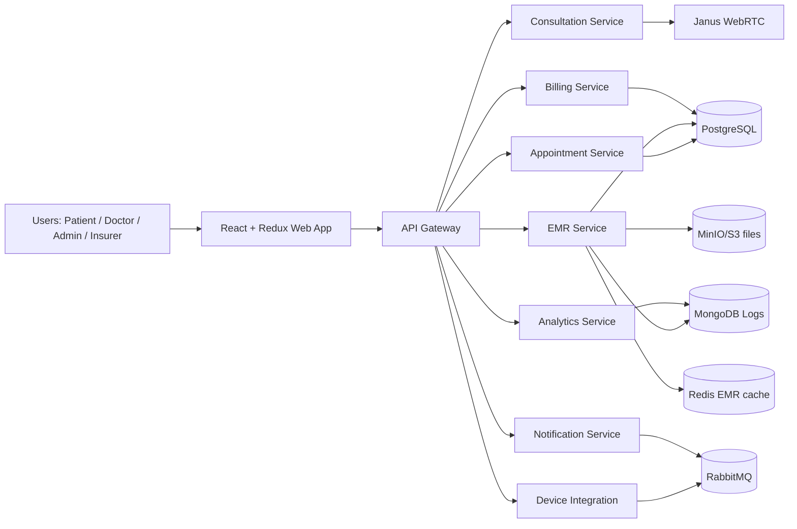
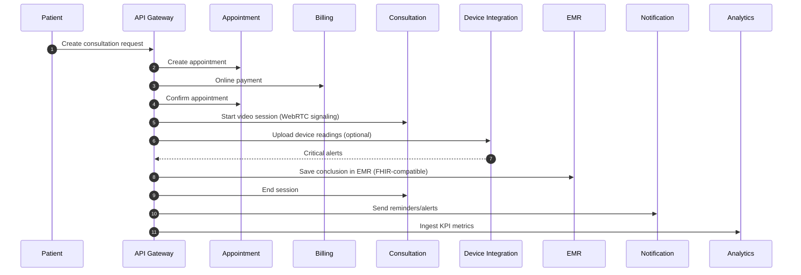

# TeleMedHub Architecture

## 1) High-level architecture

## 2) Consultation pipeline

## 3) Security and compliance layer

- RBAC roles: `patient`, `doctor`, `admin`, `insurance_representative`.
- Access scoping:
  - patient: own data only;
  - doctor: assigned patients only;
  - admin: full management;
  - insurer: billing/coverage data only.
- Token-based auth with signed access tokens (JWT-like HMAC).
- Sensitive EMR fields encrypted before storage.
- Access audit log for every EMR read/write operation.
- Compliance-oriented controls for 152-ФЗ/HIPAA:
  - least privilege access,
  - auditability,
  - encrypted data in transit/storage (design-level).

## 4) Optional improvements implemented

1. NLP complaint analysis for pre-triage (Group A-1).
2. Speech-to-protocol auto-fill (Group A-2).
3. Doctor recommendation by symptoms (Group A-4).
4. Insurance integration (claims/approval API) (Group B-3).
5. Video node balancing across Janus nodes (Group C-1).
6. EMR caching for sub-2s reads (Group C-2).
7. Async file upload pipeline in consultation sessions (Group C-3).
8. Interactive symptom questionnaire (Group D-2).
